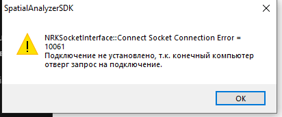
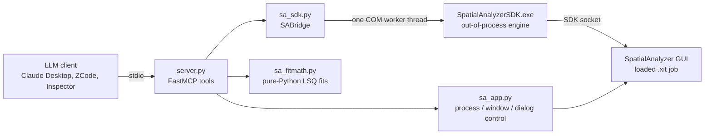

# SpatialAnalyzer MCP Server

[](https://github.com/Gilihard/spatial-analyzer-mcp/actions/workflows/ci.yml)
[](LICENSE)
[](https://www.python.org/downloads/)
[](#requirements--install)
[](https://modelcontextprotocol.io)

A [Model Context Protocol](https://modelcontextprotocol.io) server that lets an
LLM client **drive SpatialAnalyzer (SA)** — New River Kinematics' industrial
metrology package — through its COM SDK: inspect a measurement job, fit
geometry, align and average point groups, build frames, move objects and read
deviations back, all as tool calls.



## Why this is not a thin wrapper

SA is not a function API — it is a **step machine**: you name a step, set its
typed arguments, execute it and read the results back:

```python
SetStep("Fit Geometry to Point Group")
SetGeometryTypeArg("Geometry Type", "Cylinder")   # an enum: needs a VARIANT workaround
SetObjectNameArg("Group to Fit", "cloud")
SetStringArg("Resulting Object Name", "cyl1")
ExecuteStep()                                      # -> status 2 = done
```

Everything hard about this repo comes from that: the SDK COM object ships
**without a type library**, so `[out]` byref parameters and enum arguments
cannot be passed through plain dynamic dispatch; the engine is an
out-of-process `SpatialAnalyzerSDK.exe` that has to be born in the right
order or it silently no-ops every step; SA never overwrites an object name;
measurements are to the reflector centre, not the surface; and SA's own USMN
network solution is *not* an arithmetic mean. All of it is documented in
[`AGENTS.md`](AGENTS.md), with the confirmed step and argument names.



## Requirements & install

- Windows, Python 3.10+, SpatialAnalyzer installed and licensed.
- `pip install -r requirements.txt`
  (if `pywin32` import errors: `python Scripts\pywin32_postinstall.py -install`)

## Quickstart

```bat
python test_sdk.py            :: COM bridge smoke test (no SA needed)
:: open SpatialAnalyzer (Utilities -> SDK Settings enabled), then:
python test_sdk.py localhost  :: live connect + construct a test point group
python server.py              :: MCP server over stdio (waits for messages)
```

Every tool self-bootstraps: the first COM call launches or attaches SA and the
SDK engine as needed. `sa_status` is the only tool that never spawns the
bridge.

## Clients

Claude Desktop — add to `%APPDATA%\Claude\claude_desktop_config.json`:

```json
{"mcpServers": {"spatial-analyzer": {"command": "python",
  "args": ["C:\\Path\\To\\SA MCP\\server.py"]}}}
```

ZCode — `python build_mcp.py` writes the `spatial-analyzer` entry into
`~/.zcode/cli/config.json` (user scope = every project; `--scope workspace` =
only this repo), then reload MCP in the client.

Manual testing: `npx -y @modelcontextprotocol/inspector python server.py`.

## Tools

| Tool | Purpose |
|------|---------|
| `sa_status` | Server alive + connected? Call first. Never spawns the bridge. |
| `sa_ensure_file(path)` | **Work on a job file, attach-first**: if SA already has it loaded, attach without reloading (in-memory state kept); else save the current job, open the file, force-restart SA with it if the open fails. |
| `sa_current_file()` | Report which job file SA appears to have loaded (session tracker + window caption). |
| `sa_open_file` | Raw open/import of a `.xit` (`Open SA File` / `Import SA File`) — always discards the current job. |
| `sa_launch`, `sa_ensure_running`, `sa_is_running`, `sa_connect` | Process / connect control. |
| `sa_dismiss_dialogs` | Close SA modal dialogs blocking an MCP step, right now (unconditional). |
| `sa_dialog_watchdog` | Background auto-closer of SA modals (`start`/`stop`/`status`). Armed automatically; acts only while a COM call is in flight, so manual GUI work is never interrupted. |
| `sa_run_step`, `sa_construct_point` | Generic step runner + example tool. |
| `sa_delete` | Delete objects (whole groups/frames/geometry: `Delete Objects`) and/or individual points of a group (`Delete Points`) in one call (points first). |
| `sa_average_groups` | Average several point groups into one group by matching target name (`Average a set of Groups`) — the "USMN as an averager" job, no instruments or network solving. Coordinates are a plain arithmetic mean; the step's RMS/avg/max describe the WORST point, not the whole merge. Replaces a same-named result group by default. |
| `sa_unify_groups` | Unify several point groups — **align by least squares AND merge**. `method="usmn"` (default) runs `Locate Instruments (USMN)` with `AutoReject Outliers and Resolve`, derives the instruments from the source groups' observations and excludes every other point group of the collection (a re-used target name makes USMN fail silently); the solve is retried because it is non-deterministic. `method="fit"` is the explicit fallback: copy -> `Best Fit Transformation - Group to Group` -> apply -> `Average a set of Groups` (no outlier rejection). Reports the step's RMS plus its own deterministic per-source `agreement` block. **`method="usmn"` is not a plain average**: USMN has its own weighting scheme, so its composite sits ~0.03 mm off the mean of the same groups, and the solve also relocates the instruments in the job. `method="fit"` reproduces the arithmetic mean exactly and changes nothing. |
| `sa_create_frame` | Create a frame: on an existing object's local CS, or origin + X-axis through two measured points (Z along working Z). Replaces a same-named frame by default. |
| `sa_set_working_frame` / `sa_reset_working_frame` / `sa_current_working_frame` | Activate a frame / deactivate (back to WORLD) / read the active one. |
| `sa_move_objects` | Move objects **in place** — translation and rotation — relative to a frame: a 6-DOF delta in the active working frame (default), translation only, a delta in WORLD (+scale), or the delta between two named frames. |
| `sa_object_transform` | Read one object's pose (4x4 matrix + Fixed XYZ X/Y/Z, Rx/Ry/Rz) in the active working frame — capture it before/after a move. |
| `sa_best_fit_transform` | **Best-fit (least-squares) transform moving one point group ONTO another** (`Best Fit Transformation - Group to Group`), with a full deviation report and an optional move. Choose the fit freedoms (`allow_x/y/z/rx/ry/rz`, `allow_scale`). Every point's deviation is recomputed from the returned transform and listed **worst first**; `tolerance_mm` flags the ones past it as `outliers` without excluding anything. `exclude_points` re-fits without the named targets (temp copies of both groups, removed afterwards) — the "drop the bad point and recompute" loop; excluded points keep their deviation under `excluded_deviations`. `apply=True` moves the corresponding group **plus** everything named in `move_objects` in one step (frames, fitted geometry and vector groups built on it travel with it), and `verify_after_move` re-reads the result. |
| `sa_inspect_project` | List collections, or objects-by-type in a collection (full hierarchical names, optionally points per group). |
| `sa_point_coordinates` | Read-only export of working coordinates (+ stored offsets) of a group or an explicit point list. `format="canvas"` is a token-lean variant: the whole set as one CSV text, constant offsets reported once. |
| `sa_best_fit` + `sa_best_fit_<shape>` | Best-fit plane/sphere/cylinder/cone/circle/line. |
| `sa_best_fit_from_points` | Best fit to an explicit point list across any groups/collections. |
| `sa_fit_fixed` + `sa_fit_fixed_<shape>` | Fit with a FIXED radius/diameter/apex angle and a chosen compensation side. |
| `sa_identify_geometry` | Offline shape identification of a point cloud (works from raw coordinates, no SA). |
| `sa_geometry_props`, `sa_fit_quality`, `sa_best_fit_report`, `sa_fit_clean` | Geometry parameters, reflector-compensated deviations/outliers, fit+report, robust iterative rebuild (tolerance or sigma x MAD, optional physical outlier deletion). |
| `sa_show_objects` / `sa_hide_objects`, `sa_show_points` / `sa_hide_points`, `sa_show_hide_by_type` | Graphics show/hide of objects, points, or whole object types. |
| `sa_project_points` | Project point groups/points onto object(s) at their closest point -> new point group. |
| `sa_compare_points_objects` | Deviation whiskers: compare points to object(s) -> new vector group. |
| `sa_vector_group_props`, `sa_vector_group_style` | Vector-group statistics (+ per-vector dump) / styling (colours, tolerance band, auto-range). |

## Typical flows

```python
# Work on a job without discarding the already-open copy, then inspect:
sa_ensure_file(r"C:\jobs\job.xit")     # attach-first
sa_inspect_project(collection="A")

# Project points onto a fitted plane:
sa_project_points(objects=["Plane"], point_groups=["TopPoints"],
                  result_group="TopPoints_projected", collection="A")
# -> {projected: True, result_count: N, skipped: [...], replaced: ...}
# (status_code is advisory: SA can report code 3 while still creating the
#  points - success is decided by the result group's actual contents)

# Frame on a cylinder's local CS, activate it, then delete leftovers:
sa_create_frame(frame_name="frame_shell", reference_object="MCP_BF_cylinder",
                collection="A")
sa_set_working_frame(frame_name="frame_shell", collection="A")
sa_reset_working_frame()                       # back to WORLD
sa_delete(objects=["MCP_BF_cylinder_old"],
          points=["network::1", "network::2"], group="network",
          collection="A")

# Move objects relative to a frame (translation + rotation, in place):
sa_move_objects(objects=["MCP_BF_cylinder"], dx=10, dz=-2.5,
                rx=0, ry=0, rz=90, collection="A")
# -> the 6-DOF delta is applied in the ACTIVE working frame, rotations about
#    its origin; activate the target frame first with sa_set_working_frame.
sa_move_objects(objects=["MCP_BF_cylinder"], mode="frame_to_frame",
                source_frame="frame_start", destination_frame="frame_end",
                collection="A")            # move BY the delta between two frames
sa_object_transform(object="MCP_BF_cylinder", collection="A")
# -> {ok: True, matrix: [...], fixed_xyz: {x, y, z, rx, ry, rz}}

# Move one group onto another, look at the deviations, drop the bad point,
# recompute, then move the group together with its surroundings:
sa_best_fit_transform(reference_group="Nominal", corresponding_group="Measured",
                      collection="A", tolerance_mm=0.2)
# -> {computed: True, matrix: [...], fixed_xyz: {...},
#     stats: {rms_deviation, max_deviation, ...}, pairs: N,
#     deviations: [{target, deviation, included, outlier}, ...],  # worst first
#     outliers: ["4"], worst_point: {...}}
sa_best_fit_transform(reference_group="Nominal", corresponding_group="Measured",
                      collection="A", exclude_points=["4"],
                      apply=True, move_objects=["frame_node", "cylinder_node"])
# -> the fit drops target 4 (temp copies of both groups, then deleted) and the
#    corresponding group + the two companions move in one step;
#    stats_after_move re-reads the result to prove it landed on the reference.

# Identify a cloud's shape fully offline:
sa_identify_geometry(coordinates=[[x, y, z], ...])
# -> {best_geometry: "cylinder", confidence: "high", recognized: True,
#     candidates: [...], notes: [...]}
```

## SA quirks that affect results

Details in [`AGENTS.md`](AGENTS.md):

- SA never overwrites an object name, so tools delete a same-named target
  first (`replaced: True`).
- Best-fit geometry auto-creates a "cardinal points" group that every fit
  tool purges.
- Measurements are to the reflector centre, so fit-quality tools compensate
  by the stored per-point offset (19.05 mm SMR etc.).
- Mid-step modal dialogs ("Object Not Found" ...) are auto-closed by the
  watchdog while a COM call is running, so calls do not hang.

## Tests

```bat
python tests/run_all.py       :: every offline regression check, one summary
python tests/check_fitmath.py :: or one at a time
```

The checks need no SpatialAnalyzer and no COM engine — they pin the step and
argument contracts, the COM argument transport, the ref-list layout and the
fit math against stubs. See [`tests/README.md`](tests/README.md).

## Troubleshooting

| Symptom | Cause / fix |
|---------|-------------|
| `NRKSocketInterface::Connect Socket Connection Error = 10061` (see screenshot above) | The SDK engine started before SA's SDK listener was up, and it now blocks every later `Connect`. Close SA, `taskkill /F /IM SpatialAnalyzerSDK.exe`, start SA again (Utilities -> SDK Settings enabled) and retry. A 10061 right after a cold start is often just "listener not bound yet" — retry before assuming a wedge. |
| Every step returns empty results on a loaded job | The engine is unconnected: it silently no-ops steps. Check `sa_status`, then let a tool re-bootstrap the bridge. |
| `pywin32` import error | `python Scripts\pywin32_postinstall.py -install` |
| A `.xit` path with non-ASCII characters is "not found" | Never type such a path inline into a REPL over a pipe (console codepage mangles the bytes) — read it from a UTF-8 file or pass a programmatic value. |
| A tool "succeeded" but nothing appeared in SA | A step argument name was silently ignored: a `Set*Arg` setter returns `True` even for a bogus argument name. Copy the exact names from SA's MP tree or the MP Command Reference. |

## Extending

1. Find the exact step + argument names — SA's MP tree, the SA SDK examples
   folder, or the *MP Command Reference* PDF shipped with SA.
2. Add an `@mcp.tool()` in `server.py` that sets the step + args and calls
   `ExecuteStep()`; mirror `sa_construct_point`.
3. Follow the design rules in [`AGENTS.md`](AGENTS.md): COM threading, the
   InvokeTypes pattern for enum/out-param arguments, delete-before-create,
   cardinal-group purge.

## License

MIT — see [LICENSE](LICENSE). SpatialAnalyzer is a trademark of New River
Kinematics, Inc.; this project is not affiliated with NRK.
